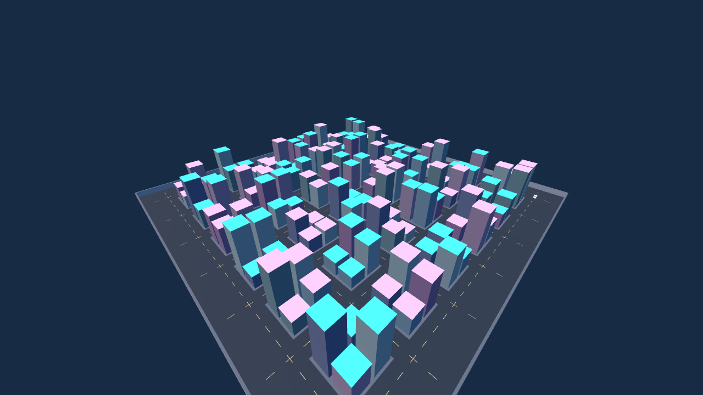

# Neon Borough VR

An original GTA-inspired city courier prototype for **Meta Quest 2, 3 and 3S**.
Built with Godot 4.6.3 and OpenXR. Explore a small procedural city, drive the gold
car, escape police, and complete delivery contracts to earn cash.

## Download the APK

[Download Neon-Borough-VR.apk (about 26 MB)](https://github.com/markovandermerwe549-ops/vrgameingsss/raw/refs/heads/main/downloads/Neon-Borough-VR.apk)

[APK and checksum](downloads/) · [Download the source project](https://github.com/markovandermerwe549-ops/vrgameingsss/archive/refs/heads/main.zip)

Sideload the APK using **SideQuest** with Quest Developer Mode enabled, then open
**Neon Borough VR** from **Unknown Sources**. USB debugging must be approved inside
the headset. Alternatively: `adb install -r Neon-Borough-VR.apk`.

See [installation and controls](docs/INSTALL-AND-CONTROLS.txt) for the complete guide.

## How to play

1. Approach the cyan courier terminal and press **A** to collect a package.
2. Approach your gold car and press **A** to enter.
3. Drive away from both police cars. Stay more than 38 metres away for 9 seconds.
4. Follow the cyan delivery beacon. Stop, exit the car, then press **A** to deliver.
5. Return to the terminal for another contract. Cash and completed jobs save locally.

| Control | Action |
| --- | --- |
| Left stick | Walk; steer, throttle and reverse in the car |
| Right trigger | Accelerate |
| Right grip | Brake |
| Right stick | Snap turn on foot |
| Right A / left X | Collect, deliver, enter or exit a stopped car |
| Right B | Return to hub; cancel current job and keep banked cash |

## Scope and validation

This is a small original prototype with a procedural city, traffic, a drivable
car, two police cars, four rotating delivery destinations, collision damage,
HUD guidance, generated sound effects and locally saved progress. It contains
no Rockstar assets, GTA map, multiplayer or combat.

Mission logic and desktop OpenGL rendering were tested in the build environment.
The APK passed signature, alignment, archive, native ARM64 and VR manifest checks.
**It has not been tested on a physical Quest**; installation, tracking, controller
input, audio, comfort and headset performance still need device testing.

## Source

Open `project.godot` in Godot 4.6.3. Desktop fallback controls are WASD, mouse,
**E** to interact, **Space** to brake, and **R** to return to the hub.

[Development and Android export notes](docs/DEVELOPMENT.txt).

Third-party notices for Godot and the Khronos OpenXR loader are in `LICENSES.txt`
and embedded in the APK. Package ID: `org.neonborough.vr`.
